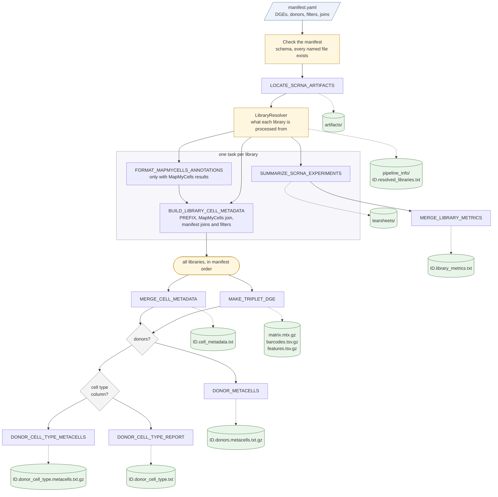

# mccarroll/scrna-aggregation

## Introduction

**mccarroll/scrna-aggregation** is a Nextflow pipeline that aggregates single-library scRNA-seq results (outputs of the Nextflow scRNA pipeline, stored on
Google Cloud) into one analysis. A YAML manifest names the DGE of each library, with optional donors, cell metadata filters and joins. The pipeline finds the artifacts of
every library, summarizes them, merges the libraries into one sparse expression matrix and one cell metadata table, and, when the libraries have donors, reports
and aggregates expression per donor and cell type.

The main steps are:

1. Check the manifest and locate the artifacts of each library (`LOCATE_SCRNA_ARTIFACTS`), then resolve what each library is processed from (`LibraryResolver`; a
   plain-text record is written to `pipeline_info/`).
2. Summarize each library (`SUMMARIZE_SCRNA_EXPERIMENTS`) and merge the library metrics (`MERGE_LIBRARY_METRICS`).
3. Convert the MapMyCells annotations, if there are any (`FORMAT_MAPMYCELLS_ANNOTATIONS`), and build each library's cell metadata with the manifest's joins and filters
   (`BUILD_LIBRARY_CELL_METADATA`).
4. Merge the cell metadata (`MERGE_CELL_METADATA`) and the DGEs into one sparse matrix (`MAKE_TRIPLET_DGE`).
5. With donors: the donor by cell type report (`DONOR_CELL_TYPE_REPORT`) and the donor and donor by cell type metacells (`DONOR_METACELLS`, `DONOR_CELL_TYPE_METACELLS`).



Boxes are processes (each runs in a container); yellow steps run in the Nextflow head job; green cylinders are what is published to `--outdir`
(`ID` is `--analysis_id`). The donor steps run only if every library has donors (a manifest `donor` or a village in its artifacts), and the
cell type steps only if some library has MapMyCells results; a skipped step logs a warning. [docs/data_flow.md](docs/data_flow.md) has the
channel-level detail.

The tools run in the public images `quay.io/broadinstitute/drop-seq_python:current` and `quay.io/broadinstitute/drop-seq_java:current`.

## Usage

> [!NOTE]
> If you are new to Nextflow, please refer to [this page](https://nf-co.re/docs/usage/installation) on how to set-up Nextflow. Reading `gs://` data needs Google
> Cloud credentials: see [docs/credentials.md](docs/credentials.md).

First, write a manifest. It has one `dges` entry per library:

`manifest.yaml`:

```yaml
dges:
  - dge: gs://bucket/path/LIBRARY_1.donors.digital_expression.txt.gz
  - dge: gs://bucket/path/LIBRARY_2.donors.digital_expression.txt.gz
```

Now, you can run the pipeline using:

```bash
export GOOGLE_PROJECT_ID=<your project>
nextflow run mccarroll/scrna-aggregation \
   -profile docker \
   --manifest manifest.yaml \
   --analysis_id MY_ANALYSIS \
   --outdir <OUTDIR>
```

To run the pipeline on Seqera Platform (Tower) instead, use the `launchScrnaAggregation` script from
[mccarroll_tw_clp](https://github.com/broadinstitute/mccarroll_tw_clp). It takes the same manifest and launches the run for you:

```bash
uvx --from 'https://git@github.com/broadinstitute/mccarroll_tw_clp.git' launchScrnaAggregation \
   --analysis-id MY_ANALYSIS \
   --project <your project> \
   -v manifest.yaml
```

See the mccarroll_tw_clp repository for the full list of options.

The manifest options (donor, filters, joins, defaults) and the optional parameters (`--mmc_model`, `--mmc_level`) are described in
[docs/usage.md](docs/usage.md), and the files in `<OUTDIR>` in [docs/output.md](docs/output.md). The documentation index is [docs/README.md](docs/README.md); running the
tests is described in [docs/testing.md](docs/testing.md).

> [!WARNING]
> Please provide pipeline parameters via the CLI or Nextflow `-params-file` option. Custom config files including those provided by the `-c` Nextflow option can be used to provide any configuration _**except for parameters**_; see [docs](https://nf-co.re/docs/usage/getting_started/configuration#custom-configuration-files).

## Credits

mccarroll/scrna-aggregation was originally written by James Nemesh.

The original pipeline was written by Alec Wysoker and Khalid Shakir.

## Contributions and Support

If you would like to contribute to this pipeline, please see the [contributing guidelines](.github/CONTRIBUTING.md).

## Citations

This pipeline uses code and infrastructure developed and maintained by the [nf-core](https://nf-co.re) community, reused here under the [MIT license](https://github.com/nf-core/tools/blob/main/LICENSE).

> **The nf-core framework for community-curated bioinformatics pipelines.**
>
> Philip Ewels, Alexander Peltzer, Sven Fillinger, Harshil Patel, Johannes Alneberg, Andreas Wilm, Maxime Ulysse Garcia, Paolo Di Tommaso & Sven Nahnsen.
>
> _Nat Biotechnol._ 2020 Feb 13. doi: [10.1038/s41587-020-0439-x](https://dx.doi.org/10.1038/s41587-020-0439-x).
